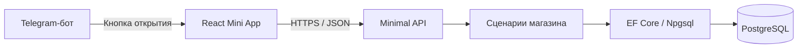

# Архитектура MVP

## Решение

Одно серверное приложение ASP.NET Core, разделённое на пять C#-проектов
по ответственности. Внутри слоёв код организуется по фичам.
HTTP-интерфейс — Minimal API.
React Mini App — отдельный frontend-проект в том же репозитории.
Для MVP frontend и backend публикуются вместе; PostgreSQL — отдельная служба.

Пять проектов: Domain, Application, Infrastructure, Api и Contracts.
Границы слоёв закреплены ссылками проектов. Это слоистый монолит с направлением
зависимостей к доменной модели и прикладным интерфейсам. Независимых
развёртываемых сервисов или отдельных баз на каждый проект сейчас нет.

Minimal API — способ описания HTTP-маршрутов, параметров, ответов и правил
доступа. Он совместим с выделенными обработчиками и сервисами сценариев;
вся логика не должна находиться в `Program.cs`.

## Состав и взаимодействие

Бот и Minimal API работают в одном серверном процессе. На текущем этапе бот
отвечает на `/start` и открывает приложение. При появлении общих сценариев
обработчик бота обращается к той же прикладной логике магазина.

## Ответственность кода

| Часть | Ответственность |
| --- | --- |
| React | Экраны, формы, фильтры, выбор варианта, состояния загрузки и ошибок. |
| HTTP endpoints | Маршрут, входные данные, авторизация, вызов сценария и HTTP-ответ. |
| Прикладные сценарии фич | Правила публикации, цены, работа с вариантами, последовательность действий. |
| CosmeticsShop.Domain | Общая модель магазина; самостоятельная библиотека. |
| CosmeticsShop.Contracts | Публичные запросы/ответы API и транспортные типы; самостоятельная библиотека. |
| CosmeticsShop.Application | Сценарии, их внутренние модели и интерфейсы доступа к внешним реализациям. |
| CosmeticsShop.Infrastructure | `ShopDbContext`, конфигурации, миграции, PostgreSQL и Telegram worker. |
| CosmeticsShop.Api | Minimal API, HTTP-обработчики, middleware и точка сборки приложения. |

## Зависимости проектов

| Проект | Прямые ссылки на проекты |
| --- | --- |
| Domain | Нет |
| Contracts | Нет |
| Application | Domain, Contracts |
| Infrastructure | Application, Domain |
| Api | Application, Contracts, Infrastructure |

Infrastructure может использовать DTO Contracts через зависимость Application.
Api подключает Infrastructure в точке сборки через `AddInfrastructure`;
HTTP-обработчики используют интерфейсы Application. Domain, Contracts и
Application не зависят от ASP.NET Core, EF Core или Telegram.Bot.

Api содержит приватную design-time зависимость EF Core Design для запуска
команд миграций. Рабочий код HTTP-обработчиков к EF не обращается.

Прикладные интерфейсы и правила находятся в `Application/Catalog`, `Auth`,
`Admin` и `Common`; маршруты — в `Api/Endpoints`. EF-реализации находятся
в `Infrastructure/Catalog`, `Auth` и `Admin`; миграции — в `Infrastructure/Data`.
Telegram worker находится в `Infrastructure/Telegram`.

## Границы Contracts

- Публичные DTO запросов и ответов, типы страниц и транспортные enum по мере необходимости.
- Доменные сущности, DbContext, TelegramOptions, настройки подключения и внутренние
  команды/результаты сценариев остаются в своих слоях.
- DTO не содержат навигации ORM и ссылок на Domain.
- Используются DTO каталога, авторизации, административных справочников и товаров,
  а также `AppInfoResponse` и `HealthResponse`.
- React получает JSON; подключить C#-сборку напрямую в TypeScript нельзя.
  TypeScript-типы описаны в frontend; генерация типов пока не настроена.

## Работа с данными и контрактами

- Frontend получает DTO; EF-сущности и навигационные свойства напрямую не выдаются.
- Публичный каталог отбирает видимые товары с хотя бы одним видимым вариантом.
- Цена вычисляется по видимым вариантам. Порядок выдачи и размер страницы ограничены.
- Чтение проецирует необходимые поля; запросы выполняются асинхронно с отменой.
- Изменение товара и его вариантов сохраняется атомарно.
- EF Core используется для запросов и транзакций. Дополнительные обобщённые
  repository/unit-of-work обёртки, mediator и шина сообщений сейчас не вводятся.
- Обработчики Application используют конкретные интерфейсы чтения/сохранения,
  а EF-реализации этих интерфейсов размещаются в Infrastructure.
- Направление зависимостей проверяется тестами проектов и скомпилированных сборок.
- Миграции применяются отдельной явной операцией.

## Доступ

Каталог может быть открыт без входа, в том числе для локального просмотра
в браузере. Административные операции доступны только после проверки данных
Telegram и серверной роли пользователя. Скрытие кнопки не является проверкой прав.
Детали входа и назначения первого администратора описаны в F03.

## Обновления Telegram

Сейчас используется long polling: один активный экземпляр worker с данным
токеном. Webhook может заменить получение обновлений при изменении размещения.
Выбор polling/webhook не меняет модель каталога или прикладные сценарии.

## Развитие

Frontend можно публиковать отдельно, сохранив API. При необходимости worker
можно вынести в отдельный процесс и использовать общие сценарии/контракты.
Это потребует настройки окружения и сборки; автоматический перенос без
доработок не предполагается. Новые сервисы выделяются при конкретной потребности.

## Источники

- [ASP.NET Core: Minimal API и контроллеры](https://learn.microsoft.com/en-us/aspnet/core/fundamentals/apis?view=aspnetcore-10.0).
- [Microsoft: архитектуры веб-приложений](https://learn.microsoft.com/en-us/dotnet/architecture/modern-web-apps-azure/common-web-application-architectures).
- [Telegram: получение обновлений](https://core.telegram.org/bots/api#getting-updates).
